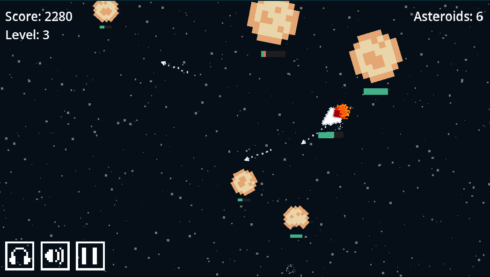
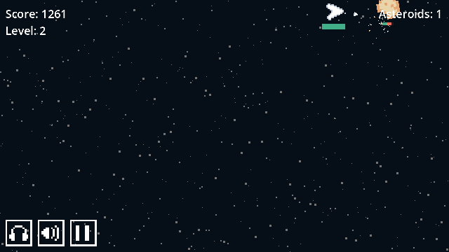
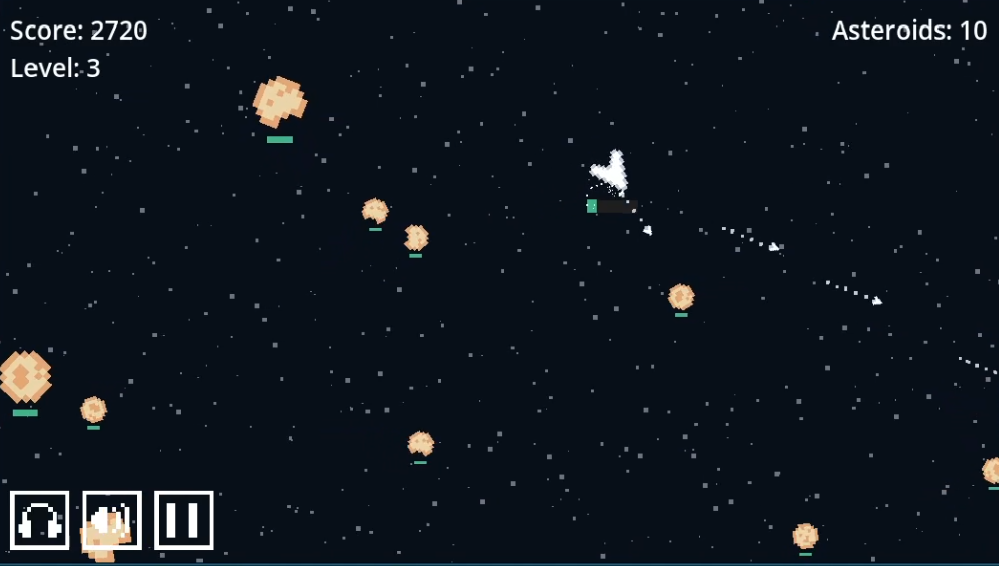

# Asteroids

My remake of the arcade classic, made with Godot: you fly a ship in a field of rocks, shoot them into
smaller pieces and try to clear the screen before they wear you down.

It's game #4 of my [20 Games Challenge](https://20_games_challenge.gitlab.io/), where you remake classic
games one after the other to learn an engine.

**Play it in the browser or download it here: https://kozumagames.itch.io/asteroids**

## How it plays

The ship turns, thrusts and keeps drifting when you let go, so you have to aim and brake at the same time.
Everything that leaves one side of the screen comes back on the other.

- Each level spawns two more rocks than the last one, at random sizes.
- A rock splits in two when destroyed, and those split again once. The smaller the rock, the more points.
- Rocks and ship have a health bar. After a hit the ship blinks and can't be hit for a second.
- When the ship dies, the game starts over.
- Music, sound effects and pause have their own button in the corner.

| Keyboard | Gamepad | Does |
| --- | --- | --- |
| `A` `D` | left stick, left / right | turn |
| `W` | left stick, up | thrust |
| `Space` | bottom face button | shoot |

## Running it yourself

You need [Godot 4.5](https://godotengine.org/download/) or newer. Open `project.godot` in the editor and
press F5. The export presets for Windows, Linux and the web are already set up.

- `core/`: the game scene, the screen wrap, and the manager that spawns the rocks and keeps the score
- `entities/`: the ship, the bullet and the rock, each with its scene and script
- `components/`: health, health bar, hitbox and hurtbox, shared by the ship, the bullets and the rocks
- `utils/`: a sprite that picks a random frame, used to vary the rocks
- `assets/`: sprites (with their Aseprite files) and sounds

Damage goes through the components: a `HitboxComponent` deals damage to any `HurtboxComponent` it
overlaps, which passes it to a `HealthComponent`, which tells its owner when it runs out. The bullets and
the rocks have a hitbox, the ship and the rocks have a hurtbox.
